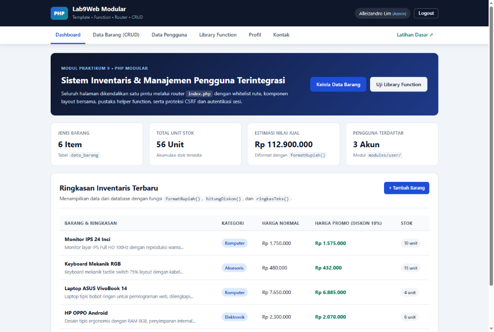
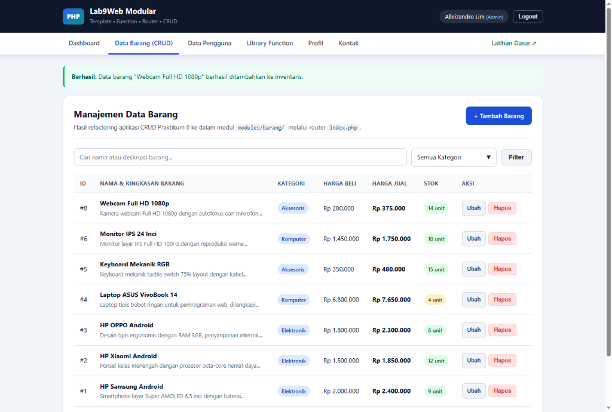

# Lab9Web - Praktikum 9: PHP Modular

Modularisasi Program, Function, Template Layout, Whitelist Routing, URL Rewrite (`.htaccess`), serta Integrasi Aplikasi CRUD Database MySQL.

## Identitas Mahasiswa

| Komponen | Keterangan |
|---|---|
| **Nama** | Alleizandro Lim |
| **NIM** | 312510*** |
| **Kelas** | I252A |
| **Program Studi** | Teknik Informatika |
| **Mata Kuliah** | Pemrograman Web |
| **Praktikum** | Praktikum 9 - PHP Modular |

---

## Tujuan Project

1. Menjelaskan pengertian, tujuan, dan manfaat modularisasi program PHP.
2. Membedakan perilaku konstruksi `include`, `require`, `include_once`, dan `require_once`.
3. Membuat template halaman web (`header.php` dan `footer.php`) yang digunakan bersama secara konsisten oleh seluruh halaman.
4. Membuat dan menggunakan pustaka *function* PHP dengan deklarasi tipe parameter dan nilai kembalian (`return`) di berbagai halaman.
5. Menyusun struktur direktori aplikasi PHP secara modular sesuai batas tanggung jawabnya (`config/`, `views/`, `helpers/`, `modules/`, `assets/`).
6. Menerapkan mekanisme *routing* satu pintu (`index.php`) berbasis daftar *whitelist* aman beserta penanganan halaman `404` dan aturan `.htaccess`.
7. Mengintegrasikan modularisasi, autentikasi sesi, proteksi CSRF, dan *routing* ke aplikasi database CRUD dari praktikum sebelumnya (`latihan1`).

---

## Kebutuhan Perangkat

- **Web Server Lokal:** Apache melalui XAMPP atau Laragon (dengan modul `mod_rewrite` dan `AllowOverride All` aktif untuk fitur URL ringkas `.htaccess`).
- **PHP:** Versi 8.x dengan ekstensi `PDO` dan `pdo_mysql` aktif.
- **Database Server:** MySQL / MariaDB (beserta phpMyAdmin atau MySQL CLI).
- **Code Editor & Perangkat Pendukung:** Visual Studio Code, Git, dan Web Browser modern (Chrome/Edge/Firefox).

---

## Cara Menjalankan Aplikasi

1. Pastikan layanan **Apache** dan **MySQL** pada XAMPP/Laragon telah berjalan.
2. Salin atau letakkan folder `Lab9Web` ke dalam direktori `htdocs` (XAMPP) atau `www` (Laragon).
3. Impor file [`database.sql`](database.sql) melalui **phpMyAdmin** atau terminal MySQL:
   ```bash
   mysql -u root < database.sql
   ```
   Skrip tersebut otomatis membuat database `latihan1` beserta tabel `data_barang` (inventaris CRUD) dan `users` (pengguna & autentikasi).
4. Buka browser dan akses aplikasi utama melalui:
   - **URL Router Standar:** `http://localhost/Lab9Web/index.php`
   - **URL Ringkas (`.htaccess`):** `http://localhost/Lab9Web/barang/list`
   - **Latihan Dasar Bertahap (Bagian C, D, E):** `http://localhost/Lab9Web/lab9_php_modular/home.php`
5. Untuk menguji fitur tambah/ubah/hapus barang serta manajemen pengguna, masuk melalui halaman **Login Admin** menggunakan akun bawaan:
   - **Email:** `admin@kampus.ac.id`
   - **Password:** `admin123`

---

## Struktur Direktori

```text
Lab9Web/
├── index.php                              # Titik masuk aplikasi & router whitelist utama
├── .htaccess                              # Aturan URL rewrite Apache (opsional & tantangan mandiri)
├── database.sql                           # Skema database latihan1 (data_barang & users)
├── README.md                              # Dokumentasi lengkap repository
├── Laporan_Praktikum_9_PHP_Modular.pdf    # Laporan resmi praktikum dalam format PDF
├── config/
│   └── database.php                       # Konfigurasi koneksi tunggal database menggunakan PDO
├── helpers/
│   └── functions.php                      # Library function umum, validasi, CSRF, flash message, & auth
├── views/
│   ├── header.php                         # Template header, status sesi, & navigasi aktif
│   ├── footer.php                         # Template footer bersama
│   ├── dashboard.php                      # Halaman ringkasan statistik inventaris & pengguna
│   ├── profil.php                         # Latihan 1: Halaman Profil mahasiswa & arsitektur
│   ├── kontak.php                         # Latihan 1 & 2: Form kontak dengan validasiEmail & ringkasTeks
│   ├── demo_function.php                  # Pengujian interaktif seluruh function helpers/functions.php
│   └── 404.php                            # Latihan 3: Halaman 404 saat rute tidak terdaftar
├── modules/
│   ├── barang/                            # Latihan 4: Refactoring CRUD Praktikum 8 (data_barang)
│   │   ├── list.php                       # Menampilkan daftar, filter kategori, & pencarian barang
│   │   ├── add.php                        # Menambah barang baru + upload gambar opsional
│   │   ├── edit.php                       # Memperbarui data barang berdasarkan id_barang
│   │   └── delete.php                     # Menghapus barang via metode POST + token CSRF
│   ├── user/                              # Bagian F & G: Modul CRUD data pengguna
│   │   ├── list.php                       # Menampilkan daftar pengguna terdaftar
│   │   ├── add.php                        # Menambah akun pengguna baru (password_hash)
│   │   ├── edit.php                       # Mengubah profil/role/password pengguna
│   │   └── delete.php                     # Menghapus pengguna via metode POST + token CSRF
│   └── auth/                              # Bagian F & Tantangan Mandiri: Modul autentikasi
│       ├── login.php                      # Halaman & pemrosesan login sesi
│       └── logout.php                     # Pemrosesan logout sesi secara aman via POST
├── assets/
│   ├── css/style.css                      # Stylesheet aplikasi utama
│   └── js/app.js                          # Konfirmasi dialog sebelum penghapusan POST
├── lab9_php_modular/                      # Latihan dasar berurutan sebelum integrasi router
│   ├── pesan.php                          # Bagian C.3: File teks contoh untuk include/require
│   ├── uji-include.php                    # Bagian C.3: Pengujian perilaku Warning pada include
│   ├── uji-require.php                    # Bagian C.3: Pengujian perilaku Fatal Error pada require
│   ├── header.php & footer.php            # Bagian D: Template dasar multi-halaman
│   ├── home.php, profil.php, about.php, kontak.php
│   ├── helpers.php                        # Bagian E: Function suhu, predikat nilai, & total belanja
│   ├── latihan-function-1.php             # Pemanggilan helpers.php halaman pertama
│   ├── latihan-function-2.php             # Pemanggilan helpers.php halaman kedua
│   └── style.css                          # Stylesheet latihan dasar
└── docs/
    └── screenshots/                       # Bukti tangkapan layar seluruh tahapan pengujian
```

---

## Daftar Rute Aplikasi (`index.php`)

Seluruh rute dikelola melalui array `$routes` (*whitelist*) pada [`index.php`](index.php):

| Parameter `page` | URL Rewrite (`.htaccess`) | File Tujuan | Metode | Akses |
|---|---|---|---|---|
| `dashboard` *(default)* | `/Lab9Web/dashboard` | `views/dashboard.php` | `GET` | Publik |
| `profil` | `/Lab9Web/profil` | `views/profil.php` | `GET` | Publik |
| `kontak` | `/Lab9Web/kontak` | `views/kontak.php` | `GET`, `POST` | Publik |
| `function/demo` | `/Lab9Web/function/demo` | `views/demo_function.php` | `GET` | Publik |
| `barang/list` | `/Lab9Web/barang/list` | `modules/barang/list.php` | `GET` | Publik |
| `barang/add` | `/Lab9Web/barang/add` | `modules/barang/add.php` | `GET`, `POST` | Wajib Login |
| `barang/edit` | `/Lab9Web/barang/edit?id=1` | `modules/barang/edit.php` | `GET`, `POST` | Wajib Login |
| `barang/delete` | `/Lab9Web/barang/delete` | `modules/barang/delete.php` | `POST` (CSRF) | Wajib Login |
| `user/list` | `/Lab9Web/user/list` | `modules/user/list.php` | `GET` | Wajib Login |
| `user/add` | `/Lab9Web/user/add` | `modules/user/add.php` | `GET`, `POST` | Wajib Login |
| `user/edit` | `/Lab9Web/user/edit?id=1` | `modules/user/edit.php` | `GET`, `POST` | Wajib Login |
| `user/delete` | `/Lab9Web/user/delete` | `modules/user/delete.php` | `POST` (CSRF) | Wajib Login |
| `auth/login` | `/Lab9Web/auth/login` | `modules/auth/login.php` | `GET`, `POST` | Publik |
| `auth/logout` | `/Lab9Web/auth/logout` | `modules/auth/logout.php` | `POST` (CSRF) | Wajib Login |
| *(rute di luar daftar)* | `/Lab9Web/admin/rahasia` | `views/404.php` (`HTTP 404`) | Semua | Publik |

---

## Langkah Praktikum dan Ringkasan Pelaksanaan

1. **Pengujian `include` dan `require` (Bagian C):** Membuat `pesan.php`, `uji-include.php`, dan `uji-require.php` di `lab9_php_modular/`. Saat file yang dipanggil tidak ditemukan, `include` menghasilkan *Warning* tetapi baris `"Sesudah pemanggilan"` tetap dijalankan; sebaliknya `require` menghasilkan *Fatal Error* dan langsung menghentikan eksekusi skrip.
2. **Pembuatan Template Multi-Halaman (Bagian D & Latihan 1):** Memisahkan kerangka awal HTML dan navigasi ke `header.php` serta penutup dokumen ke `footer.php`. Halaman `home.php`, `profil.php`, `about.php`, dan `kontak.php` memuat keduanya dengan `require_once __DIR__ . '/...'` tanpa pengulangan kode layout.
3. **Pembuatan Library Function (Bagian E & Latihan 2):** Menyusun fungsi bertipe jelas pada `lab9_php_modular/helpers.php` dan `helpers/functions.php`, mencakup `formatRupiah()`, `hitungDiskon()`, `validasiEmail()`, `ringkasTeks()`, `konversiCelciusKeFahrenheit()`, `tentukanStatusNilai()`, `hitungTotal()`, serta `e()` untuk HTML *escaping*. Fungsi-fungsi ini digunakan ulang pada Dashboard, Data Barang, Data Pengguna, Profil, Kontak, dan halaman Demo Function.
4. **Penataan Direktori & Router Aman (Bagian F, G, & Latihan 3):** Menata aplikasi ke dalam folder `config/`, `views/`, `helpers/`, `modules/`, dan `assets/`. File `index.php` memvalidasi tipe `is_string($page)` dan mencocokkannya ke array *whitelist* `$routes`. Permintaan rute asing (seperti `page=admin/rahasia`) atau tipe array (`?page[]=x`) ditolak secara aman dengan kode status `404` dan tampilan `views/404.php`.
5. **Refactoring CRUD & Tantangan Mandiri (Bagian H, I, Latihan 4, & Tantangan Mandiri):**
   - Memindahkan koneksi database `latihan1` ke `config/database.php` menggunakan PDO *prepared statements*.
   - Memecah fitur CRUD inventaris barang ke `modules/barang/` dan manajemen pengguna ke `modules/user/`.
   - Mengimplementasikan keempat poin **Tantangan Mandiri**: navigasi aktif (`navActiveClass()`), pesan *flash* sukses/gagal setelah CRUD (`setFlashMessage()` & `renderFlashMessage()`), pembatasan akses halaman modul dengan sesi login (`requireLogin()`), serta aturan URL *rewrite* melalui `.htaccess`.

---

## Bukti Screenshot Pengujian

Seluruh tangkapan layar pengujian tersimpan di dalam folder [`docs/screenshots/`](docs/screenshots/):

| No. | Aspek Pengujian | File Screenshot |
|---|---|---|
| 1 | Struktur Direktori Modular `Lab9Web` | `docs/screenshots/01_struktur_direktori.png` |
| 2 | Pengujian `include` saat File Hilang (*Warning*, lanjut) | `docs/screenshots/02_uji_include_warning.png` |
| 3 | Pengujian `require` saat File Hilang (*Fatal Error*, berhenti) | `docs/screenshots/02b_uji_require_fatal.png` |
| 4 | Template Multi-Halaman (`lab9_php_modular/home.php`) | `docs/screenshots/03_template_multihalaman.png` |
| 5 | Pengujian Library Function (`helpers/functions.php`) | `docs/screenshots/04_library_function.png` |
| 6 | Dashboard Utama & Menu Navigasi Aktif (`index.php`) | `docs/screenshots/05_routing_dashboard.png` |
| 7 | Halaman 404 pada Rute Tidak Terdaftar (`page=admin/rahasia`) | `docs/screenshots/06_routing_404.png` |
| 8 | Pengujian URL Ringkas `.htaccess` (`/Lab9Web/barang/list`) | `docs/screenshots/07_htaccess_clean_url.png` |
| 9 | Halaman Login Autentikasi (`page=auth/login`) | `docs/screenshots/08_auth_login.png` |
| 10 | Form Tambah Data Barang - Create (`page=barang/add`) | `docs/screenshots/09_crud_barang_add.png` |
| 11 | Hasil Simpan Barang & Flash Message Sukses (`barang/list`) | `docs/screenshots/10_crud_barang_list_sukses.png` |
| 12 | Form Ubah Data Barang - Update (`page=barang/edit&id=1`) | `docs/screenshots/11_crud_barang_edit.png` |
| 13 | Hasil Hapus Barang via POST + CSRF (`barang/delete`) | `docs/screenshots/12_crud_barang_delete_sukses.png` |
| 14 | Modul Manajemen Pengguna (`page=user/list`) | `docs/screenshots/13_crud_user_list.png` |

### Pratinjau Utama





---

## Kendala yang Ditemukan dan Cara Mengatasinya

1. **Masalah Path File CSS Saat Menggunakan URL Rewrite `.htaccess`:**
   - *Kendala:* Ketika halaman diakses melalui URL bertingkat seperti `/Lab9Web/barang/list` (tanpa `index.php?page=`), pemanggilan `<link rel="stylesheet" href="assets/css/style.css">` secara relatif ditafsirkan browser sebagai `/Lab9Web/barang/assets/css/style.css` sehingga stylesheet gagal dimuat (404).
   - *Solusi:* Membuat fungsi `baseUrl()` pada `helpers/functions.php` yang menghitung direktori dasar berdasarkan `dirname($_SERVER['SCRIPT_NAME'])`. Dengan `baseUrl('assets/css/style.css')`, path aset selalu mengarah secara konsisten ke `/Lab9Web/assets/css/style.css` baik melalui URL standar maupun URL *rewrite*.
2. **Peringatan *"Cannot modify header information - headers already sent"* Saat Redirect di Modul CRUD:**
   - *Kendala:* Apabila `index.php` langsung mencetak `views/header.php` sebelum mengeksekusi file modul (`modules/barang/add.php` atau `delete.php`), maka pemanggilan `header('Location: ...')` setelah proses simpan/hapus maupun `requireLogin()` akan gagal karena output HTML sudah telanjur dikirim.
   - *Solusi:* Mengeksekusi `$contentFile` terlebih dahulu di dalam *output buffer* (`ob_start()` dan `ob_get_clean()`) pada `index.php`. Dengan demikian, modul dapat melakukan *redirect* HTTP atau mengubah variabel `$pageTitle` dengan bersih sebelum `views/header.php` dirender.
3. **Potensi Deklarasi Ulang Function (*Function Already Declared*):**
   - *Kendala:* Memuat file helper dari beberapa tempat dengan `include` atau `require` biasa berisiko memicu fatal error `Cannot redeclare function ...`.
   - *Solusi:* Selalu menggunakan `require_once` dengan konstanta `__DIR__` terpusat pada titik masuk `index.php`.

---

## Jawaban Singkat Pertanyaan Pemahaman (Bagian L)

1. **Pengertian & manfaat modularisasi:** Teknik memecah program menjadi modul-modul kecil dengan tanggung jawab spesifik. Manfaatnya: menghindari duplikasi kode (*reusability*), mempermudah pemeliharaan/perubahan tampilan, mempermudah pelacakan bug (*debugging*), dan mendukung pembagian kerja tim tanpa konflik pada satu file besar.
2. **Perbedaan `include` dan `require` saat file hilang:** `include` hanya memunculkan *Warning* dan eksekusi baris berikutnya tetap dilanjutkan, sedangkan `require` menghasilkan *Fatal Error* dan menghentikan eksekusi skrip seketika.
3. **Alasan `require_once` tepat untuk konfigurasi database:** Koneksi database wajib tersedia agar aplikasi dapat bekerja (`require`), sekaligus hanya boleh dimuat satu kali per permintaan (`_once`) agar tidak membuka koneksi ganda atau mendeklarasikan ulang konfigurasi.
4. **Perbedaan parameter, argumen, dan nilai `return`:** Parameter adalah variabel penampung pada definisi function; argumen adalah nilai nyata yang dikirim saat function dipanggil; nilai `return` adalah hasil keluaran yang dikembalikan function ke pemanggil untuk disimpan atau diolah lebih lanjut.
5. **Mengapa header dan footer dipisahkan dari konten:** Karena elemen kerangka HTML, stylesheet, judul situs, navigasi, dan hak cipta bersifat seragam di semua halaman. Pemisahan membuat pembaruan menu cukup dilakukan di satu file saja.
6. **Fungsi `index.php` pada pola routing:** Berperan sebagai *front controller* (pintu masuk tunggal) yang memuat konfigurasi dan helper, memvalidasi parameter `page`, memilih modul konten yang sesuai, serta menyatukan tampilan header dan footer.
7. **Mengapa router wajib memakai *whitelist* rute:** Untuk membatasi agar hanya file modul resmi yang telah didaftarkan pengembang yang boleh dieksekusi oleh server.
8. **Risiko menggabungkan input `page` langsung ke `require`:** Membuka celah keamanan serius *Path Traversal* / *Local File Inclusion (LFI)* (contohnya `?page=../../config/database` atau file sensitif sistem operasi) sehingga penyerang dapat mengeksekusi atau membaca file di luar modul tampilan.
9. **Fungsi `RewriteCond` dan `RewriteRule` pada `.htaccess`:** `RewriteCond %{REQUEST_FILENAME} !-f` dan `!-d` memeriksa agar file/folder fisik nyata (seperti CSS, JS, gambar) tetap dilayani langsung oleh Apache, sedangkan `RewriteRule ^(.+)$ index.php?page=$1 [QSA,L]` meneruskan path URL virtual lainnya ke parameter `page` milik router `index.php` beserta *query string* aslinya.
10. **Pemetaan bagian aplikasi CRUD ke direktori modular:**
    - `config/`: Koneksi database PDO/MySQLi (`database.php`).
    - `views/`: Komponen layout bersama (`header.php`, `footer.php`, `dashboard.php`, `404.php`).
    - `helpers/`: Fungsi format mata uang, diskon, ringkas teks, escaping HTML, validasi email, CSRF, dan flash message (`functions.php`).
    - `modules/`: Logika serta tampilan fitur spesifik per domain, misalnya CRUD barang (`modules/barang/`), CRUD user (`modules/user/`), dan autentikasi (`modules/auth/`).
